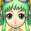
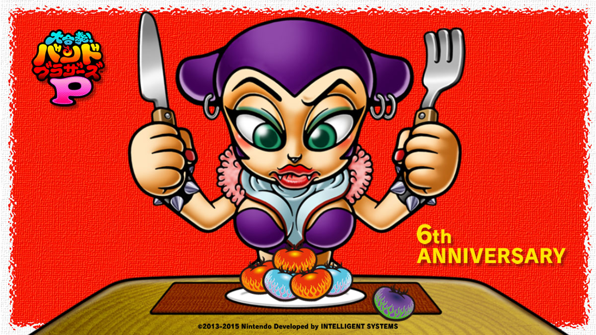
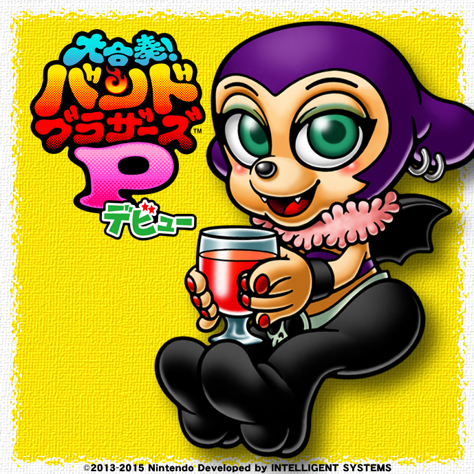

# Complete Collection of Vocaloid "Live Voice Artists" from the 3DS game 大合奏!バンドブラザーズP

  

This repository contains the complete collection of all eleven Vocaloid "Live Voice Artists" released for Daigasso! Band Brothers P.

The files were extracted using Degausser and are provided in BBPV format. You can use the same tool to import them into your own save data.

 ### Collection of 11 Singers

 | Release Date | Singer | Portrait |
 | --- | --- | --- |
 | 2013/11/14 | バーバラ (Barbara) |  |
 | 2014/03/28 | 蒼姫ラピス (Aoki Lapis) |  |
 | 2014/04/24 | 神威がくぽ (Camui Gackpo) |  |
 | 2014/08/27 | GUMI |  |
 | 2015/01/31 | KYO |  |
 | 2015/01/31 | YUU |  |
 | 2015/01/31 | WIL |  |
 | 2015/04/02 | ギャラ子 (galaco) |  |
 | 2015/05/06 | MAYU |  |
 | 2015/12/25 | Sachiko |  |
 | 2016/01/05 | アルスロイド (ARSLOID) |  |

## Useful Resources

- English Translation [Jam With The Band P](https://github.com/Neobeo/JamWithTheBandP-English)
- [Degausser](https://github.com/AdibSurani/Degausser)
- [Naderino's](https://gbatemp.net/threads/daigasso-band-brothers-p.368948/post-9466190) 9,000+ Song Collection [Artisted - BBP Renamed and Romanized.rar](https://drive.google.com/file/d/1zsuhBsvQQT860p5aMst-AKhprqPpJkCt/view?usp=sharing)

  

## Credits

Special thanks to the original uploaders and everyone who contributed to preserving this content. :shipit:

  

